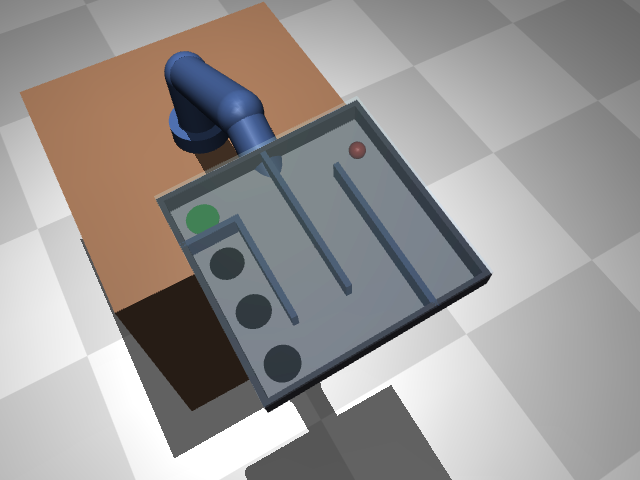

# connectome-tray-balance

**Fly-brain-wired controllers for robot-arm balance and maze puzzles**

A robot arm in MuJoCo learns to balance a ball on a tray and then to solve **tilt-maze puzzles** (roll the ball through a maze to the goal). Its "brain" (the policy) is a recurrent network whose **wiring is copied from the fruit-fly connectome** (FlyWire v783). Only the fly-brain network is studied here.

This is a feasibility / reproduction setup, not a finished study.

**Project page with videos:** https://nihal4.github.io/connectome-tray-balance/ (from `index.html`; enable it under Settings → Pages → Deploy from branch `main`, folder `/ (root)`).



```
robot sensors (24-66) ─► W_in ─► 64 input neurons ─┐
                                                  │   1000 fly neurons, ~53k real connections
                     (repeat K=4 times)  h ← (1-a)h + a·tanh(A·h + u + b)
                                                  │   A: wiring + excitatory/inhibitory sign FIXED,
64 output neurons ◄───────────────────────────────┘      only connection strengths trained
        │
        └──► linear head ──► 5 joint targets for the arm
```

## Fly-robot mode: camera into the eye, commands out of the command neurons

The second way to use the connectome. Instead of the 1000 most connected neurons with
inputs and outputs picked by us, the robot plugs into the fly's own channels:

| robot | fly brain (FlyWire cell types) | count |
|---|---|---|
| 16x16 wrist camera, this frame | R8 photoreceptors, right eye | 256 |
| same camera, previous frame (motion) | R7 photoreceptors, right eye | 256 |
| joint angles/speeds, tray tilt | ascending neurons (body sense from the nerve cord) | 64 |
| arm commands | descending neurons (the brain's commands to the body) | 64 |
| in between | neurons on the shortest pathways: optic lobe, visual projection, central brain | ~1,900 |

Each pixel drives exactly one photoreceptor (no mixing layer), arranged roughly like the
eye. Every eye-to-command path inside the network is 3-5 synapses long. The brain is not
given the ball position, the wall map or the goal: it only sees the camera image and feels
its own joints.

```bash
python scripts/download_connectome.py          # also gets the FlyWire cell-type annotations
python scripts/build_flybrain.py               # -> data/flybrain_cam16_N2500.npz
python scripts/train.py --env tray_vision --policy connectome --subset data/flybrain_cam16_N2500.npz --profile kaggle
```

Kaggle: `notebooks/kaggle_flyrobot.ipynb`. Videos show the camera
image the brain receives in the top-left corner. Camera tasks: `tray_vision`,
`maze_fixed3_vision`, `maze3_vision`, `maze3h_vision`; a controller that uses only the camera
image solves all of them 100 %, so the picture contains everything needed.

Settings that differ automatically for this brain: 8 recurrent rounds (signals need 3-5 hops),
no leak, stronger initial connections (otherwise the camera signal fades before reaching the
command neurons), and a sparse matrix (0.5 % of neuron pairs are connected).

## Fly-brain drone: compound eye, fly wiring, flight commands

The third robot (`ctb/envs/drone.py`, notebook `notebooks/kaggle_drone.ipynb`). A fly's brain
evolved to steer flight, so here its command neurons steer a small quadcopter.

| drone | fly brain (FlyWire cell types) | count |
|---|---|---|
| compound eye, brightness per facet | R1-6 photoreceptors, both eyes | 2 x 160 |
| compound eye, ultraviolet per facet | R7 photoreceptors | 2 x 160 |
| compound eye, green per facet | R8 photoreceptors | 2 x 160 |
| airspeed, tilt, rotation, last command | ascending neurons | 64 |
| flight commands: forward, sideways, up, turn | descending neurons (32 per side) | 64 |
| in between | pathway neurons: optic lobe, visual projection (incl. LC/LPLC), central brain | ~2,900 |

**Eye.** Two eyes of 160 facets each cover almost all directions (from 15 deg across the
midline to 165 deg behind, 75 deg below to 80 deg above the horizon, about 11 deg between facets,
as in a fly the image is very wide and very blurry). The room is ray traced (7 rays per facet,
0.5 ms per step, no graphics card needed); balls are blended into every facet through the
facet's blur profile, so a far ball is a faint smudge and grows as the drone gets closer. Each
photoreceptor gets the light it sees and how much that just changed (real photoreceptors
respond strongly to change; this is what motion and looming detection build on).
Facets are matched to photoreceptors by position on the eye (approximate retinotopy from neuron
coordinates, optimal assignment), only photoreceptors that have a route to the chosen command
neurons are used, and the pathway growth keeps a route for every facet: all 960 photoreceptors
and all 64 body-sense inputs reach the commands in 3-5 synapses.

**Stabiliser = halteres.** A fly's balance reflexes run outside the brain (halteres, nerve
cord), and FlyWire maps the brain only. So a simple controller keeps the drone level and holds
the velocity and turn rate the brain asks for; the brain decides where to fly.

**Speeds, chosen to keep flying smooth:** max 1 m/s horizontal, 0.5 m/s vertical, 86 deg/s
turning; commanded velocity changes by at most 2 m/s^2 (0 to full speed in 0.5 s), tilt at most
25 deg. Brain runs at 25 Hz, stabiliser at 500 Hz.

**Task `drone_reach`.** 8 x 8 m grey room (low-contrast checker floor, striped walls, so the
eye can sense its own motion), open sky. A yellow ball (25 cm radius) appears 1.5-4 m away, anywhere in the room; the drone starts at a random place
and heading. Solved: drone centre within 30 cm of the ball, slower than 0.5 m/s, for 0.4 s.
12 s limit.

| reward term | value | why |
|---|---|---|
| getting closer | +10 per m (potential) | flying back and forth earns nothing |
| hovering on the ball | +0.5 per step (potential) | leaving gives it back, so no farming |
| solved | +20 | |
| time | -0.01 per step | |
| crash (floor, wall, above 3 m, flipped) | -10, episode ends | crashing is always worse than hovering |

No penalty on jerky commands: the stabiliser already limits acceleration, and in a first test such
a penalty mostly punished PPO's exploration noise (about -13 per episode), drowning out the
"get closer" signal; training return stayed at random-flying level for 100k steps.

**Colours (what each photoreceptor type sees).** The yellow ball is bright in R1-6 and R8 and
almost black in R7 (UV); the grey room reflects UV and green alike; the sky is UV-rich; decoys are
UV-violet. In a first version the floor was green and the ball yellow-green: the two had nearly
the same colour ratio, so a far ball against the floor was camouflaged. A detector on the eye
image picked the ball only 44 % of the time at 3-4 m; with the grey room 76 % from a single look.

**Built-in robustness (training conditions):** a new layout every episode, light wind and gusts
in random directions, drone mass +-4 %, eye noise (0.01 per photoreceptor), light level +-20 %,
floor pattern size, and up to two blue-violet decoy balls (as bright as the target, other colour).
Tests (`evaluate.py --robustness`): no wind, strong wind, 3x eye noise, three decoys, heavier
drone, and the ball made invisible (must fail).

**Checks before training** (60 rooms each):

| pilot | solved | crashed | return |
|---|---|---|---|
| hand-written, knows where the ball is | 100 % | 0 % | 52 |
| hand-written, sees ONLY the eye image (`EyeOnlyPilot`) | 83 % | 10 % | 40 |
| same, strong wind | 68 % | 13 % | 33 |
| same, ball invisible | 0 % | 25 % | -8 |
| hover in place | 0 % | 22 % | -8 |
| random flying | 0 % | 27 % | -23 |

The eye-only pilot shows the compound eye carries enough information; the invisible-ball row
shows the task cannot be solved without seeing the ball.

**Local learning check** (2-core machine, same settings as the notebook): training return rose
from -14 to about -3 and training episodes solved from 3 % to 11 % by 150k steps; the first
evaluation room (real start, unseen layout) was solved at 200k steps. Early, but learning.

```bash
python scripts/build_flybrain.py --eye compound --facets 160 --n 4000 --hops 5   # -> data/flybrain_eye160_N4000.npz
python scripts/check_mac.py --env drone_reach --subset data/flybrain_eye160_N4000.npz
python scripts/train.py --env drone_reach --subset data/flybrain_eye160_N4000.npz --profile kaggle --random_start 0.5
```

## Fly-brain Panda: a real robot arm with a gripper (`panda_reach`, `panda_lift`)

The current main robot (`ctb/envs/panda.py`). A Franka Emika Panda arm with its two-finger
gripper (model from MuJoCo Menagerie, Apache-2.0; `python scripts/download_panda.py`), set up
the way the standard manipulation benchmarks do it (Fetch, robosuite, ManiSkill):

| | design |
|---|---|
| brain commands (descending neurons) | `[dx, dy, dz, grip]` 25 times a second: move the gripper up to 2 cm, open/close. Inverse kinematics + the arm's servos do the joints, like a nerve cord turning descending commands into leg movements |
| body sense (ascending neurons) | gripper position and velocity, gripper opening, last command |
| right eye | compound eye (160 facets) on a "head" beside the table, looking at the workspace: finds the block |
| left eye | compound eye (160 facets) on the wrist, looking past the fingers: lines the gripper up |
| brain | the same 4,000-neuron fly-brain network as the drone (`flybrain_eye160_N4000.npz`) |
| task `reach` | bring the gripper to the yellow 5 cm block (new place every episode, up to 2 blue decoys) and stay in the pre-grasp pose, 1.5 cm above it: within 3 cm for 5 steps (0.2 s) |
| episode | 60 steps (2.4 s), no early end |
| reward (ManiSkill style, per step, max 1) | reach `1 - tanh(5 d)`; +1 inside the 3 cm zone; success (in the zone for 0.2 s) = maximum. Bounded, nothing to farm |

Why two eyes: a fly-like eye has ~11 deg facets; seen from beside the table, a 5 cm block is a
faint dot inside one facet, and an eye-only detector placed it with a median error of ~5 cm
(the task needs 3 cm). Robot labs pair an overview camera with a wrist camera for the same
reason. With the left eye on the wrist, the block fills many facets up close.

Checks (40 episodes each):

| pilot | solved |
|---|---|
| hand-written, knows where the block is | 100 % |
| hand-written, sees ONLY the two eye images (+ own hand position) | 100 % (also with decoys) |
| same, block invisible | 0 % |
| do nothing / random | 0 % / 0 % |

Two problems found and fixed while building it: the hand lagged behind its commands (fixed
with a target point the hand follows, as in Fetch), and in a first version the eye sat behind
the robot, where the arm blocked its view of the table.

First desktop run (700k steps): the brain finds the yellow block, ignores decoys and ends within
3 cm of the target 72-83 % of the time (median 2.1 cm, height within 1 cm), but jitters at ~13 cm/s.
The first success rule also demanded speed < 5 cm/s; PPO's exploration noise alone moves the hand
~12 cm/s, so a perfect pilot with that noise succeeded only 27 % and training almost never saw a
success. Success is now a 0.2 s dwell inside 3 cm (as in standard reaching tasks): the same 700k
brain, unchanged, solves 80 %; the pilots 100 % (also with training noise); idle/random 0 %.

**Result (v8, `results/v8_panda_reach/`):** main run peaked at 90 % (1.3M steps) and then
declined; a fine-tune from that best brain (lower learning rate, more practice blocks near the
table edges) reached 94 % across a 5 x 5 grid of block positions (was 73 %), 90 % clean, 75 %
with 3x eye noise, 70 % with brightness changes of +-40 % (training: +-20 %), 5 % with the block invisible. Remaining
weak spot: the extreme corner tips of the table.

### Task `panda_lift`: grasp the block and lift it

Same robot, eyes and brain, plus **touch**: the body stream gets "each finger presses on
something" (0 / 0.5 / 1), like a fly's mechanosensors. Grasp the yellow block between both
fingers and lift it 8 cm, held for 0.2 s. 100 steps (4 s). ManiSkill PickCube-style reward per
step (max 1): reach `1 - tanh(5 d)` to the block centre; +1 while held between both fingers;
+2 x lift progress while held (lifting only counts while held, so pushing or flicking earns
nothing); success = maximum.

Checks (40 episodes each; solved = lifted and held at the end of the episode, as in training, the evaluation chart, the videos and `fly eval`):

| behaviour | return | solved |
|---|---|---|
| random / do nothing | 2 | 0 % |
| hover above the block (what the reach brain does) | 13 | 0 % |
| touch the block with a closed gripper | 15 | 0 % |
| grasp but never lift | 31 | 0 % |
| scripted pilot + PPO-like noise (0.3) | 52 | 78 % |
| scripted pilot | 66 | 92 % |

Training starts from the reach brain (`--init_from`; same inputs and outputs), which scores 14.5
on lift at step 0, the "hover above" level.

`--lift_reward goal` (ManiSkill PickCube style): while held, the block is rewarded for being near a
point 8 cm straight above where it started, `2 (1 - tanh(10 d))`; success = held within 2.5 cm of
that point for 0.2 s. Added after the brain learned to grasp but carried the block sideways at low
height: with the height-only reward, lifting while carrying 8 cm sideways scored 77.6 vs 75.8
straight up; with the goal reward 52.1 vs 94.4 (straight up solves 95 %, scripted pilot 98 %,
with noise 78 %). Switching a resumed run keeps the old evaluation history and best brain as
`*_height_until_<N>k*` and starts new ones; the choice is saved in the run's config and used by
training, the evaluation chart, the videos and `fly eval`.

### Task `panda_place`: pick and place into a bin

Same robot, eyes, body sense and touch. A shallow red bin (14 x 14 cm, 1.5 cm rim) appears at a new
place every episode, at least 15 cm from the yellow block; the eyes see it as a dark patch with some
UV and no green, unlike the table, the block and the blue decoys. Grasp the block, carry it over the
bin, lower it onto the floor and let go. Success = block resting inside the bin (centre within
4.5 cm of the bin centre, down on its floor), touched by neither finger, for 0.2 s. 150 steps (6 s).
Staged reward, every stage pays more than the one before (divided by 6): reach the block (0..1) ->
held (+1) -> carried over the bin (+2 x closeness in x/y) -> lowered over it (+0.5) -> in the bin,
still held (4.5) -> released (5) -> success (6).

Teacher (`place_teacher`, true block and bin positions; training targets only): grasp as in lift,
lift 8 cm, carry over the bin, lower, open, hand up. Solves 100 % of 40 episodes (median 2.8 s),
95 % with action noise 0.15, 90 % with 0.3. Training plan: start from the v10 lift brain, 10
DAgger rounds, then PPO with the asymmetric critic (23 true-state numbers: + bin position and
block-to-bin); PPO now starts from the best imitation round, not the last.

**Result (v11, `results/v11_panda_place/`, one seed, 0.77M steps, under 4 h):** teacher rounds alone
reached 82-88 % solved; PPO from the best round held 84-92 %. Best brain, `fly eval 50`: clean 92 %,
no decoys 92 %, eye noise x3 86 %, light +-40 % 58 %, block hidden 0 %. On 200 new layouts: 84 % solved,
block centre lands a median 1.0 cm from the bin centre, solved in a median 2.7 s. Most common miss:
holding the block over the bin without lowering it (7 %).

### Task `panda_sort`: sort by colour, like a sorting station

One block per episode, yellow, blue or orange at random, on the near half of the table; three
identical red bins in a row along the far side (left / centre / right, +-1.5 cm jitter). Yellow goes
left, blue centre, orange right; let go inside the right bin. A block in another bin earns nothing
(reported as `wrong_bin`). Same staged reward and success rule as place, 150 steps, no decoys.
Colours as the fly eye sees them (brightness, UV, green): yellow (1, 0.05, 1), blue (0.75, 0.9,
0.15), orange (0.95, 0.05, 0.2); bins (0.2, 0.65, 0.05). Critic: place's 23 true-state numbers + the
block's colour (one-hot). Teacher: 100 % solved (98 % with action noise 0.3), never the wrong bin.
Fixed video layouts: seeds 13 (yellow), 11 (blue), 10 (orange). Starts from the v11 brain.

**Result (v12, `results/v12_panda_sort/`, one seed, 0.5M steps, ~3 h):** 98 % solved at 515k;
`fly eval 50`: clean 92 %, eye noise x3 84 %, light +-40 % 50 %, block hidden 0 %. On 300 new layouts:
95 % solved (yellow 98, blue 92, orange 97 %) and **0 blocks in a wrong bin**; misses never reached any
bin.

First design (dropped after 5 imitation rounds): bins coloured like the blocks, at random places.
The student alone solved 0 % and got worse each round (imitation loss 0.04 -> 0.13): there was
always a big bin of the block's own colour, so "find the yellow thing" no longer found the block.

### Lighting (`--light_log`)

The default scene varies brightness x 0.8-1.2 per episode; the `dim_or_bright_x2` test doubles that
to x 0.6-1.4 (earlier pages called it "2x dimmer or brighter", which was wrong). The v12 sorting brain
solves 50 % there, and **0 of 30 at a fixed x 0.6 or x 1.4** (and at x 0.4 or x 2.5): it only works
near the brightness it practised under. Fix: `--light_log 0.69` practises at anything from half to
double brightness (training only), and a new test `light_0.4x_or_2.5x` checks brightness beyond even
that range.

### Light-adapting eyes (`--eye_adapt`)

Fly photoreceptors adapt to the light level: each receptor type scales its gain to the light it
currently receives, so the brain gets contrast rather than absolute brightness. With `--eye_adapt`
each receptor type (R1-6, R7, R8) of each eye divides by its own running average over the eye
(30 % of the way per step, 25 Hz), scaled to the old normal-light average; photon noise is added before
adaptation and grows like sqrt(light), so dim scenes are noisier. A global brightness change is then
cancelled (the eye output at x0.4 and x2.5 differs from x1 by < 0.003 without noise), so two new tests
check what adaptation cannot simply cancel: `uneven_light` (one side of each eye's view x2, the other
x0.5) and `tinted_light` (receptor types x0.7 / x1.4 / x1.0). Training uses the normal x0.8-1.2 light
only, so every other brightness is a test it never practised.

**Result (v14, `results/v14_panda_sort_adapt/`):** from v12, normal light only, 1.47M steps. Fixed brightness
x0.4-2.5: 100 % at every level (v12: 0-90 %, v13: 0-92 %); tinted light 98 % (v12 15 %, v13 30 %); uneven light
x2/x0.5 48-60 %, x1.4/x0.7 88 % (v12 and v13: 3 % at x2/x0.5); normal light 98 % of 300 layouts, no wrong bin.

### Smell: ripe or rotten (`panda_smell`)

**The brain grows a sense.** `scripts/grow_smell_brain.py` keeps the trained 4,000-neuron brain exactly
(same neurons and synapses in the same order, so learned strengths carry over one to one) and appends the
fly's smell pathway from FlyWire: one olfactory receptor neuron per glomerulus type and antenna (53 types x
2 = 106, `ORN_<glomerulus>`), and the strongest pathways from them into the existing brain (164 projection
neurons, 128 antennal-lobe local neurons, lateral-horn and other neurons): 4,476 neurons, 65,568 synapses.
Every command neuron is 3 synapses (median) from a smell receptor. (The mushroom body, the fly's odour
learning centre, is not on these shortest routes and is not included yet.)

**Smell from measured fly data.** `scripts/build_smell_table.py` takes, for the receptor of each glomerulus,
its response to each chemical from DoOR (Database of Odor Responses; Muench & Galizia 2016; CC BY-SA 4.0;
consensus response minus spontaneous rate; 49 of 53 glomeruli have data, 279 of 424 pairs measured, the rest
count as 0). Fruit recipes (simplified): ripe = fruity esters (isopentyl acetate, ethyl butyrate, hexyl
acetate, ethyl hexanoate) + a little ethanol; rotten = fermentation (ethanol, acetic acid, ethyl acetate,
diacetyl) + a little ester. Ripe drives mostly DM2, DM3, VM5v, VM2; rotten mostly the acid sensors DC4,
DP1l, DP1m.

**The sense.** Two antennae beside the gripper. Concentration = Gaussian fall-off with distance (sigma 10 cm)
x turbulence flicker (log-normal, sd 0.25 per step) + faint background; receptor output tanh(2 x drive) +
noise. From the start position the fruit is too far to smell (signal at noise level); close up, the
receptor pattern differs clearly between ripe and rotten.

**The task.** One fruit (the yellow block) per episode, ripe or rotten at random, looking exactly the same.
Two identical bins: ripe -> left, rotten -> right. Only smell can tell them apart. Teacher: 100 % (92 % with
action noise 0.3), never the wrong bin. Tests add `no_smell` (antennae silenced: chance is 50 %) and
`smell_noise_x3`.

### Teacher -> student (imitation, then PPO) for `panda_lift`

Pure PPO from the fly eyes (height reward, mid-task starts) learned to find, grasp and partly lift;
by 1.6M steps it had not completed a lift (it carried the block sideways at low height), but kept
going: first solved evaluation episodes at 2.15M, 12 % at 2.4M, best brain at 3.2M; mean 22.8 %
solved over the last 13 evaluations, 16 % on a fresh 50-episode test (0 % with the block hidden).
Discovered from reward alone. Details, robustness and success clips: `results/v9_panda_lift/`. Vision-based robot policies are usually
trained teacher -> student instead (Genesis manipulation example; asymmetric actor-critic, Pinto et
al. 2017; FlyGM used imitation first, then PPO):

* **Teacher** (`ctb/envs/panda.py: lift_teacher`): a hand-written controller using the TRUE block
  position; it decides from the current situation only, so it also rescues situations the student
  got into (98 % solved from normal starts, 100 % with corner blocks, 87 % with action noise 0.3,
  98 % after 25 random steps first). Training targets only; never used in evaluation or videos.
* **Student**: the fly brain, eyes + body sense only. The previous command and the
  gripper-closed flag are hidden from it (copying them is the "copycat" shortcut of imitation).
* **DAgger** (`ctb/imitate.py`, `--imitate N`): round 1 = 30k teacher steps, 15 passes; later
  rounds 15k steps where the teacher drives 50 %, 25 % ... of the time and labels every step;
  data aggregated (up to 120k examples); after each round the student is tested ALONE on 50 normal
  episodes (same evaluation as PPO). Checkpointed per round, including the data.
* **Then PPO** continues from the imitated brain with an **asymmetric critic** (`--privileged`):
  the critic gets the true state (17 numbers); the policy slices them away (changing them changes
  the fly brain's action by exactly 0.0).
* **Gripper** `--grip_mode absolute`: the command is the finger target (closed stays closed),
  as in ManiSkill / Fetch, instead of a per-step nudge.

Checks before the desktop run: the fly brain can fit the teacher (validation error = training
error, still falling after 20 passes); a pure imitation student (30k teacher steps) grasped in
40 % and completed the lift alone in 1 of 30 episodes; a 3-round DAgger test went
0 % -> 7 % -> 7 % solved alone. A first attempt failed for a known reason: too little training
per round (sideways errors larger than the teacher's own spread).

**Result (v10, `results/v10_panda_lift_imitate/`, one seed, 2.12M steps):** started from the v9
brain; 10 DAgger rounds (165k steps), then PPO with the asymmetric critic, goal reward, absolute
gripper. The student alone solved 0 % -> 56 % (round 7) -> 4 % (round 10: once it drove itself, the
data filled with its own near-misses and it lost the final lift, keeping a clean reach and grasp).
PPO then took it to 84 % by 0.6M and 84-96 % on every evaluation after 0.7M (mean 91 % from 1.5M).
Best brain, `fly eval 50`: clean 90 %, no decoys 90 %, eye noise x3 96 %, light +-40 % 60 %, block
hidden 0 % (v9: 16 / 24 / 8 / 20 / 0 %). Precision on 200 new layouts, same rule for both: held
within 2.5 cm of the point 8 cm above the start at the end 94 % (v9 0 %); median distance from that
point at the end 1.3 cm (v9 20.4 cm); median largest sideways drift in the air 1.1 cm (v9 23.4 cm).
Success map (5 x 5 block positions, 8 starts each, decoys removed): 180/200, weakest along the
right edge (6/8). Weak spot: lighting changes (never varied in training).

Planned ladder: reach -> grasp and lift -> pick and place into a bin -> sort by colour into
3 bins -> add the fly's smell pathway (antennal lobe, mushroom body) and sort fruits by smell
-> colour + smell, conflicting cues -> taste by touch -> ripe vs rotten -> formalin-treated vs
natural fruit (assumed fly response; no published fly data on formaldehyde).

**How others connect fly brains to bodies** (checked before building):
- NeuroMechFly v2 (Wang-Chen et al. 2024, *Nature Methods*): the brain-level controller sends a
  two-number descending signal into leg pattern generators; the eye model bins a camera image
  into ~721 ommatidia. Layered control, as here.
- FlyGM (arXiv 2602.17997): whole-brain FlyWire graph with fixed signed synapse counts; observations
  enter through afferent neurons, actions are read from efferent neurons; neuron state carries
  over time (memory); imitation of an expert first, then PPO.
- FLYNN (arXiv 2607.00025): connectome-derived network for vision-based navigation, robust to
  vision loss.
- FlyCNS (arXiv 2609.28816): connectome statistics used only as a prior on brain-body
  communication.
- No published fly-brain controller for a robot arm was found.

## Environments (`--env`)

| name | task | obs | time limit | holes |
|---|---|---|---|---|
| `tray` | keep a rolling ball on a flat tray | 24 | 500 steps (10 s) | – |
| `maze_fixed3` | tilt-maze puzzle, one fixed 3x3 maze | 47 | 300 | 0 |
| `maze3` | a **new random 3x3 maze every episode** | 47 | 350 | 0 |
| `maze3h` | random 3x3 mazes with holes | 47 | 350 | 2 |
| `maze4` | random 4x4 mazes | 66 | 550 | 3 |
| `maze5` | random 5x5 mazes with some loops | 91 | 750 | 5 |

Shared by all: a 5-joint arm (shoulder yaw/pitch, elbow, wrist pitch/roll), position-controlled, holding a tray on a short post at 50 Hz. The action (5) is joint-target offsets around a level home pose. The observation always starts with joint angles and velocities, the ball's position and velocity in tray coordinates, the tray normal, and the last action.

**Tray balance.** The tray has no rim. Doing nothing loses the ball in about 1 s; a hand-written PD controller keeps it for the full 10 s.

**Tilt maze (the puzzle).** Like the wooden labyrinth toy: walls, a glass lid, holes, and a green goal. The maze is generated by depth-first search, so there is exactly one route, the ball starts in the cell farthest from the goal, and from `maze3h` on, holes sit in cells beside the route, so a wrong turn or an overshoot drops the ball. **Solved** means the ball rests in the goal circle for 0.5 s; rolling through it does not count. The policy sees one bit per possible inner wall, one bit per hole and the goal position, but **not** the route: it has to work out the detours from the layout. Reward is progress along the shortest route (continuous across cells), an extra pull toward the goal centre inside the goal cell, progress toward the 0.5 s hold in the goal (taken back if the ball leaves, so hovering earns nothing), +10 when solved, −10 for a hole, and small costs for time, jerky actions and tray drift.

Reference controllers, 20 episodes each (`python scripts/check_mac.py --env maze4` prints the first two):

| | scripted planner (knows the route) | do nothing | random actions | random ±1 shaking |
|---|---|---|---|---|
| `maze_fixed3` | 100 % | 0 % | 0 % | 0 % |
| `maze3` | 100 % | 0 % | 0 % | 0 % |
| `maze3h` | 100 % | 0 % | 0 % | 0 % |
| `maze4` | 100 % | 0 % | 0 % | 0 % |
| `maze5` | 100 % | 0 % | 0 % | 0 % |

Two shortcuts were closed while building this: without the lid, a policy learned to flick the ball over the walls; without holes, the hold rule and tight time limits, random shaking solved 40–70 % of small mazes by luck.

Start-position curriculum: `--random_start 0.5` makes half of the training episodes start the ball at a random cell along the route, so the policy also practises the final turns and stopping in the goal (evaluation always uses the real start). Added after the camera maze run reached the goal but pinned the ball in the goal-cell corner instead of stopping it in the centre.

Slow, smooth motors: `--action_rate 0.1` limits how much each joint target may change per step (a full swing takes 0.4 s, like a servo with a speed limit). Under hard shaking the ball's top speed drops from 2.35 to 0.71 m/s; the scripted planner still solves every maze. It changes the robot, so it is saved in the run's `config.json` and evaluation and videos use it automatically; keep the same value when resuming.

Suggested curriculum: `maze_fixed3` (one puzzle) → `maze3` (generalise to new puzzles) → `maze3h` (holes) → `maze4` → `maze5`. Holes start later on purpose: in a first test, PPO with holes from the start spent its first 200k steps mostly learning to avoid them. Robustness tests apply to every environment; for `maze_fixed3` runs there is also an **unseen mazes** test.

## Repo layout

```
ctb/envs/tray_arm.xml        MuJoCo model (arm, tray, ball)
ctb/envs/tray_balance.py     TrayBalance env (+ robustness knobs, PD controller)
ctb/envs/labyrinth.py        tilt-maze puzzle env (maze generator, scripted planner)
ctb/envs/drone.py            fly-brain drone: quadcopter, stabiliser, compound eye, reach task
ctb/envs/panda.py            fly-brain Panda: arm + gripper, hand-space control, head + wrist compound eyes
ctb/envs/__init__.py         registry: build_env("maze3"), make_env(...)
ctb/policies.py              connectome policy for Stable-Baselines3 PPO
ctb/safety.py                thread limits, duty cycle, thermal / RAM / battery guards
ctb/profiles.py              presets: mac, kaggle, smoke
scripts/download_connectome.py
scripts/download_panda.py    Panda model from MuJoCo Menagerie
scripts/build_subset.py      pick N neurons + input/output neurons
scripts/check_mac.py         one-minute health check
scripts/train.py             PPO training of the fly-brain network (real | shuffled wiring)
scripts/evaluate.py          returns, robustness tests, video
scripts/plot_runs.py         learning curves
scripts/view_env.py          live MuJoCo viewer
scripts/desktop/             always-on Ubuntu PC: setup.sh, fly command, auto-resume service, progress videos + dashboard
scripts/watch_maze.py        maze diagnostic videos (real start, and k cells before the goal)
scripts/build_flybrain.py    fly-robot brain: eye/body-sense inputs, command outputs, pathways
                             (--eye compound: the drone's two compound eyes)
notebooks/kaggle_train.ipynb 1,000-neuron network, ball/maze given as numbers
notebooks/kaggle_flyrobot.ipynb  fly-robot brain, camera tasks (train, test videos, export zip)
notebooks/kaggle_drone.ipynb fly-brain drone with compound eyes
tools/make_notebook_*.py     generate the notebooks (edit there, not in the .ipynb)
results/                     saved results (models, curves, videos) per experiment
```

## On the Mac (M1, 8 GB)

```bash
python3 -m venv .venv && source .venv/bin/activate
pip install -r requirements.txt

python scripts/download_connectome.py           # ~100 MB, once
python scripts/build_subset.py --n 1000
python scripts/check_mac.py --env maze3         # ~1 min, tells you if everything works

mjpython scripts/view_env.py --env maze4 --mode scripted     # watch the planner solve a maze
python scripts/train.py --env maze_fixed3 --policy connectome --profile smoke   # 1-2 min pipeline test
python scripts/train.py --env maze_fixed3 --policy connectome --profile mac     # short real run
```

### How the Mac is protected (`--profile mac`)
- only **2 threads** for PyTorch/BLAS and **2 environments**, process runs at low priority (`nice`)
- **duty cycle**: 45 s of work, then 15 s rest
- checks `pmset -g therm` every 10 s; if macOS reports throttling, it rests 2 min
- stops and saves if free RAM drops below 1 GB, or if on battery below 30 %
- stops and saves after **30 minutes** of compute (`--max_minutes` to change)
- `Ctrl+C` also saves. Continue any stopped run with `--resume`.

Everything is adjustable, e.g. `--threads 1 --work_s 30 --rest_s 30` for an even cooler run. Use the Mac to check and debug; do the long runs on Kaggle.

## On Kaggle

1. Push this repo to GitHub (e.g. `nihal4/connectome-tray-balance`).
2. Open `notebooks/kaggle_train.ipynb` in Kaggle (File → Import Notebook), turn **Internet ON**.
3. Set `REPO_URL` and `ENVS` in the first cell, then **Save & Run All**.

For each environment in `ENVS` the notebook trains the fly-brain policy (optionally the shuffled-wiring control), then runs robustness tests and saves models, curves and one video per run to `/kaggle/working`. Download `runs_export.zip` and put interesting runs under `results/`.

For the fly-robot (camera) tasks use `notebooks/kaggle_flyrobot.ipynb` instead. Its settings cell picks the task (`ENV`), brain size, `ACTION_RATE` (slow motors, default 0.1) and `RANDOM_START` (curriculum, default 0.5). Runs with slow motors are named `<env>-connectome-real-s0-slow`, so they never mix with the older fast-motor runs. The notebook trains, tests, records one video per test plus maze diagnostics, and zips everything.

## On an always-on Ubuntu PC (`scripts/desktop/`)

For runs of days or weeks (tested target: Ubuntu 24.04, i3-8100, 12 GB). One-time setup:

```bash
git clone https://github.com/nihal4/connectome-tray-balance ~/flybrain/repo
bash ~/flybrain/repo/scripts/desktop/setup.sh
```

It installs CPU PyTorch + MuJoCo in `~/flybrain/.venv`, downloads the connectome, builds the
brains, runs the check, and sets up three services:
- training, started only with `fly start` and never at boot (`--profile desktop`: full speed, no
  time limit, memory and CPU limits so it cannot freeze the PC, cools down above 90 C);
- a watcher that records a progress video of the newest checkpoint every 100k steps (starts at boot);
- a dashboard at `http://<pc>:8080` with curves, latest numbers, CPU temperature and videos (starts at boot).

Control it over SSH with `fly`: `fly job maze3_vision 3000000`, `fly start`, `fly status`,
`fly log`, `fly eval`, `fly stop`, `fly update`.

Power cuts: checkpoints every 50k steps are written to a temporary file and swapped in, with
the previous one kept as `.bak` (used automatically if the newest is unreadable). After a reboot
or power cut, `fly start` resumes from the last checkpoint (training never starts by itself).

## Robustness tests (`scripts/evaluate.py --robustness`)

Run on policies trained only on the clean task: sensor noise (0.1, 0.3), **blind** (ball position and velocity hidden), heavy ball (3×), random pushes. These are the tests for later research questions, in the spirit of FLYNN (robustness to sensory loss).

## Results so far

- **v1, tray balance** (`results/v1_tray_balance/`): the 1,000-neuron network solves it by 100k steps and is robust to noise, a heavy ball and pushes; it fails when the ball is hidden.
- **v2, fixed maze** (`results/v2_maze_fixed3_local/`, local, 400k steps): not solved yet; it often reaches the goal but cannot stop the ball there.
- **v3, Kaggle mazes** (`results/v3_maze_kaggle/`, 1M steps): fixed maze 30–40 % solved by 1M and rising; random mazes 0 %. Also exposed a reward hack (hovering in the goal), fixed afterwards.
- **v4, fly-robot brain by vision** (`results/v4_flyrobot_tray_vision_local/`, local, one seed): wired from the eye to the command neurons and seeing only a 16x16 camera image, the fly brain learned to keep the ball on the tray at ~200k steps; best model 100 % on new episodes, 0 % when the ball is hidden from the camera.
- **v5, fly-robot brain by vision, Kaggle** (`results/v5_flyrobot_tray_vision_kaggle/`, 1M steps, ~2.7 h): full 10 s from 250k steps on; 100 % clean, with a 3x heavier ball and with random pushes; 0 % with camera noise or the ball hidden. Videos of all three tests included.
- **v6, camera maze, first run** (`results/v6_maze_vision_kaggle/`, Kaggle, one seed): 0 % solved, return flat at about +5.3 from 1.05M steps. The video shows why: the brain rolls the ball through the whole maze to the goal in under a second, then pins it in the corner of the goal cell instead of stopping it in the middle. Navigation learned, final stop not. Fixes: start-position curriculum and a stronger pull to the goal centre (success rule unchanged).
  Resumed with both fixes from 1.65M to ~2M steps: eval return rose from ~5 to 7.7–11.2 (the ball now comes off the wall towards the centre) but still 0 % solved; the arm and ball move too fast to stop the ball on the spot.
- **v7, camera maze solved with slow motors** (`results/v7_maze_vision_slow_kaggle/`, Kaggle, 2M steps, one seed): fresh run with `--action_rate 0.1 --random_start 0.5`, brain unchanged. First solve at 350k, 100 % from 1.1M, 100 % on every eval from 1.65M; solves in ~130 steps and stops the ball in the goal centre. Robustness: heavy ball 100 %, pushes 60 %, camera noise 0 %, ball hidden 0 %, **unseen mazes 0 %** (memorised this maze).
- **v8, Panda reach by fly eyes** (`results/v8_panda_reach/`): 94 % across the table after edge practice.
- **v9, Panda grasp and lift, PPO only** (`results/v9_panda_lift/`): first lifts at 2.15M, ~20 % solved, block carried ~20 cm sideways.
- **v10, Panda grasp and lift, teacher then PPO** (`results/v10_panda_lift_imitate/`): ~90 % solved alone by eye, block ends 1.3 cm from the target point; 60 % under +-40 % brightness changes.
- **v11, Panda pick and place into a bin** (`results/v11_panda_place/`): ~90 % solved alone by eye (84-92 %), block lands 1.0 cm from the bin centre; 58 % under +-40 % brightness changes.
- **v12, Panda sort by colour** (`results/v12_panda_sort/`): 95 % of 300 new layouts sorted, none into a wrong bin; 50 % under +-40 % brightness changes.
- **v13, sorting under changing light** (`results/v13_panda_sort_light/`): practising at x0.5-2 brightness; fixed-brightness success x0.7 92 %, x1.4 70 %, x2 62 % (v12: 15 / 0 / 0 %), still 0 % at x2.5; 91 % at normal light (v12 95 %).
- **v14, sorting with light-adapting fly eyes** (`results/v14_panda_sort_adapt/`): photoreceptor adaptation in the eye model, practised at normal light only; 100 % at every fixed brightness x0.4-2.5, tinted light 98 %, uneven light 48-60 % (v12/v13: 3 %); 98 % of 300 new layouts sorted, none into a wrong bin.
- **Next:** `maze3_vision` (new random maze every episode) to see whether the brain can learn to read walls through the eye.
- **Drone:** `drone_reach` with compound eyes (see above), ready to train with `notebooks/kaggle_drone.ipynb`.

## Notes and limits

- The arm's forearm visibly passes through the tray in some poses. It is cosmetic: arm parts are in a separate collision group and never touch the ball.
- The connectome subset is the 1000 most strongly connected neurons and the connections between them. It is not a specific brain region, and the "input" and "output" neurons are chosen by graph structure, not biology.
- The network has no memory across time steps (state resets every step). That is enough for the mazes because the layout is in every observation; memory is a natural next experiment (e.g. show the layout only at the start).
- `--wiring shuffled` keeps the same edges, signs and weights but connects them randomly; compare against it before claiming the real wiring helps.

## Data and credits

- Connectome: FlyWire, Dorkenwald et al. 2024 (*Nature*); Schlegel et al. 2024 (*Nature*).
- Processed edge list from Shiu et al. 2024 (*Nature*), github.com/philshiu/Drosophila_brain_model (MIT).
- Related work: FLYNN (Wang & Chen, arXiv 2607.00025), FlyGM (arXiv 2602.17997), Lappalainen et al. 2024 (*Nature*).
